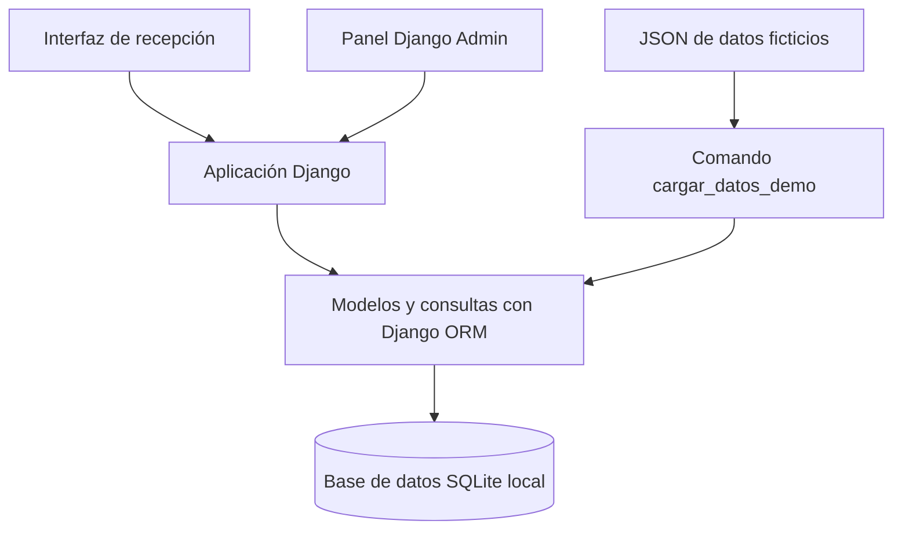

# Huellas Sanas 🐾

### Registro de pacientes y agenda de consultas para un centro veterinario

> **Proyecto académico individual · Analista Programador · INACAP Osorno**  
> **Desarrollador:** Vicente Vega Arroyo  
> **Tecnologías:** Python · Django · Django ORM · SQLite · HTML/CSS (interfaz web) · JSON (datos de demostración)

**Huellas Sanas** es una aplicación web que desarrollé para organizar tareas habituales de recepción en una clínica veterinaria: registrar mascotas y sus responsables, programar consultas y consultar la agenda de atención por fecha y estado. Complementé la interfaz de recepción con **Django Admin** para administrar mascotas y citas.

**[Explorar el repositorio](https://github.com/Vichosurf/HuellasSanas)**

---

## 1. El problema

En una recepción veterinaria, los datos de una mascota, el motivo de consulta y la hora de atención deben estar coordinados. Cuando los registros se dispersan, aumenta la dificultad para consultar el calendario y evitar reservas superpuestas.

Mi objetivo fue reunir **registro y agenda diaria en un mismo flujo**, con información visible para recepción y herramientas administrativas separadas.

## 2. La solución

Construí una interfaz para ingresar los datos básicos de la mascota y programar su consulta. La agenda permite seleccionar una fecha, revisar las atenciones por hora y distinguir si una cita está **pendiente, atendida o cancelada**.

En el módulo administrativo de Django puedo consultar y gestionar mascotas y citas, aplicar filtros y realizar operaciones de creación, consulta, actualización y eliminación de registros.

**Alcance:** es un desarrollo académico que se ejecuta en un entorno local. Las capturas muestran **datos ficticios de demostración**; no representan pacientes ni atenciones reales de una clínica.

## 3. Demostración visual

### Portada y propuesta de la aplicación


La portada resume el propósito de la herramienta: registrar pacientes y organizar la jornada de atención.

### Registro de pacientes y agenda diaria


Esta vista integra, de un lado, el formulario con datos de mascota y consulta; del otro, la agenda de la fecha seleccionada con horario, paciente, motivo y estado.

### Confirmación del registro


El mensaje de confirmación permite reconocer el resultado de una operación de registro durante la demostración.

### Administración de Django


Uso **Django Admin** para mantener los registros, consultar listados y filtrar las citas por fecha o estado. Esta vista es administrativa y se diferencia de la pantalla de recepción.

## 4. Funcionalidades

| Área | Funcionalidad documentada |
| --- | --- |
| Registro | Alta de mascota y primera cita desde un formulario web. |
| Mascotas | Nombre, especie, raza y nombre del responsable. |
| Consultas | Fecha, hora, motivo y estado de atención. |
| Agenda | Consulta diaria, selección de fecha y orden por horario. |
| Seguimiento | Conteo de citas pendientes y estados **pendiente / atendida / cancelada**. |
| Validación | Regla para impedir dos citas en la misma fecha y hora, descrita en la implementación. |
| Administración | Operaciones CRUD de mascotas y citas con búsqueda y filtros en Django Admin. |
| Demostración | Carga de registros ficticios a partir de un archivo JSON, evitando duplicados según el comando del proyecto. |

## 5. Arquitectura conceptual



Separé dos experiencias de uso: la recepción, enfocada en registrar y visualizar el día, y la administración, orientada a gestionar los registros existentes. Para persistencia local utilicé **modelos relacionados mediante el ORM de Django** sobre **SQLite**.

El diagrama resume componentes y flujo de datos a nivel conceptual; no pretende representar cada clase o módulo del código fuente.

## 6. Decisiones de desarrollo

- **Django:** utilicé su estructura de aplicación y su panel de administración para gestionar datos sin duplicar herramientas administrativas.
- **SQLite:** elegí una base de datos local apropiada para construir y probar el alcance académico del proyecto.
- **Vista unificada:** dispuse el ingreso de datos junto a la agenda para facilitar la revisión inmediata de las citas.
- **Estados visibles:** diferencié pendientes, atendidas y canceladas para reconocer la situación de cada consulta.
- **Datos de ejemplo:** incorporé una carga desde JSON para repetir demostraciones con registros ficticios.
- **Validación de horario:** documenté una regla para evitar dos citas en la misma fecha y hora; conviene acompañarla con una prueba reproducible.

## 7. Cómo ejecutar el proyecto

> **Requisitos:** Windows con PowerShell, Python y el entorno virtual `.venv` del proyecto ya preparado, con sus dependencias instaladas. Esta guía utiliza el script y las rutas proporcionadas en el proyecto; si se ejecuta en otro equipo, puede ser necesario recrear el entorno.

### Iniciar el sistema

Ubícate en la carpeta del repositorio que contiene `iniciar.ps1` y `manage.py` (en la estructura compartida, `Huellas_Sanas/`). Ejecuta:

```powershell
.\iniciar.ps1
```

El script está preparado para aplicar migraciones, cargar registros de demostración e iniciar Django. Si deseas utilizar otro puerto:

```powershell
.\iniciar.ps1 -Direccion 127.0.0.1:8001
```

**Direcciones locales por defecto:**

- Recepción y agenda: `http://127.0.0.1:8000/`
- Administración: `http://127.0.0.1:8000/admin/`

### Crear el usuario administrativo

El panel Django Admin requiere un superusuario local:

```powershell
.\.venv\Scripts\python.exe manage.py createsuperuser
```

### Cargar datos ficticios

El archivo de ejemplo está en [`Huellas_Sanas/clinica/data/mascotas_demo.json`](Huellas_Sanas/clinica/data/mascotas_demo.json). Para cargarlo desde la carpeta con `manage.py`:

```powershell
.\.venv\Scripts\python.exe manage.py cargar_datos_demo
```

Cada elemento del JSON define datos básicos de una mascota y de su primera cita. Para agregar ejemplos, se debe mantener la estructura del archivo, utilizar un horario libre y escoger uno de estos estados: `pendiente`, `atendida`, `cancelada`.

### Si faltan tablas en SQLite

Si aparece `no such table: clinica_cita`, detén el servidor y aplica las migraciones:

```powershell
.\.venv\Scripts\python.exe manage.py migrate
.\.venv\Scripts\python.exe manage.py cargar_datos_demo
```

Después vuelve a iniciar la aplicación.

## 8. Evidencia y verificaciones

| Caso | Qué se puede revisar | Estado de la evidencia |
| --- | --- | --- |
| V-01 | Mostrar formulario y agenda de la fecha elegida. | **Visible en captura**. |
| V-02 | Guardar una mascota y una cita; mostrar confirmación. | **Mensaje visible en captura**. |
| V-03 | Filtrar citas por fecha y estado en el administrador. | **Controles visibles en captura**. |
| V-04 | Impedir dos citas con el mismo día y hora. | **Regla documentada; falta registrar una prueba**. |
| V-05 | Ejecutar dos veces la carga JSON sin duplicar registros. | **Comportamiento descrito; falta registrar una prueba**. |
| V-06 | Gestionar creación, edición y eliminación desde Django Admin. | **Herramienta documentada; falta registrar el ciclo completo**. |

Las capturas y los pasos de uso muestran el alcance del desarrollo, pero no constituyen por sí solos una auditoría del código ni una batería completa de pruebas automatizadas.

## 9. Limitaciones y mejoras futuras

Este proyecto se presenta como **prototipo académico**, no como un sistema desplegado para operar una clínica veterinaria. Antes de un uso real sería necesario profundizar, al menos, en pruebas, control de acceso, respaldo de datos, privacidad de los responsables y despliegue seguro.

Como mejoras futuras consideraría documentar pruebas automatizadas de validaciones, reforzar manejo de errores y preparar una configuración de despliegue distinta del entorno local.

## 10. Autoría y contacto

Desarrollé **Huellas Sanas de forma individual** durante mi formación como Analista Programador en **INACAP Osorno**.

**Vicente Vega Arroyo**  
[GitHub: @Vichosurf](https://github.com/Vichosurf)

---

*Esta documentación describe el proyecto y las evidencias disponibles. No declara certificaciones, pruebas de rendimiento ni funcionamiento en producción.*
